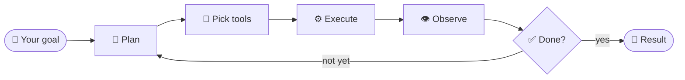
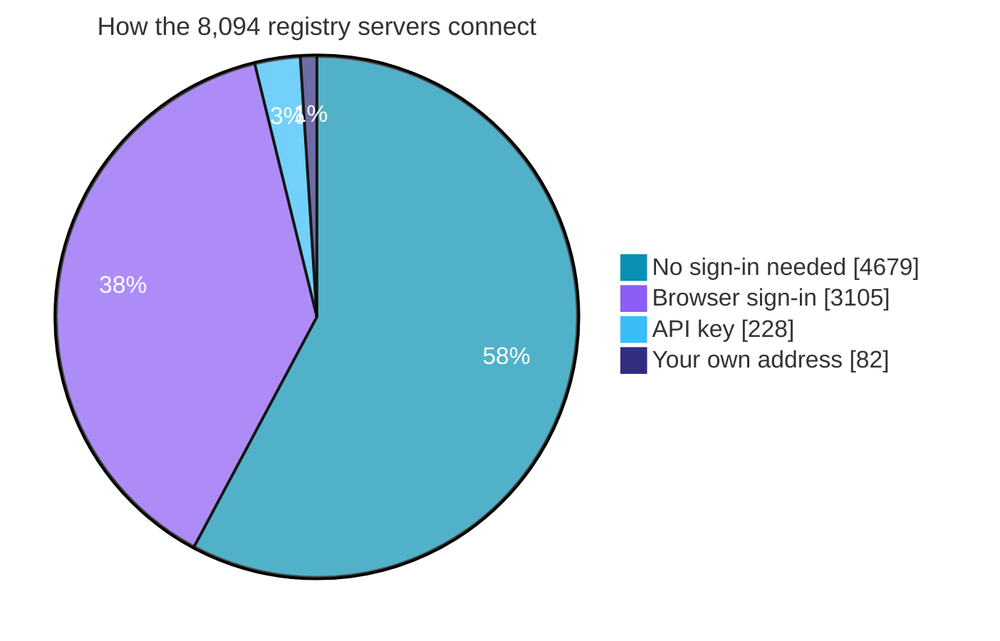
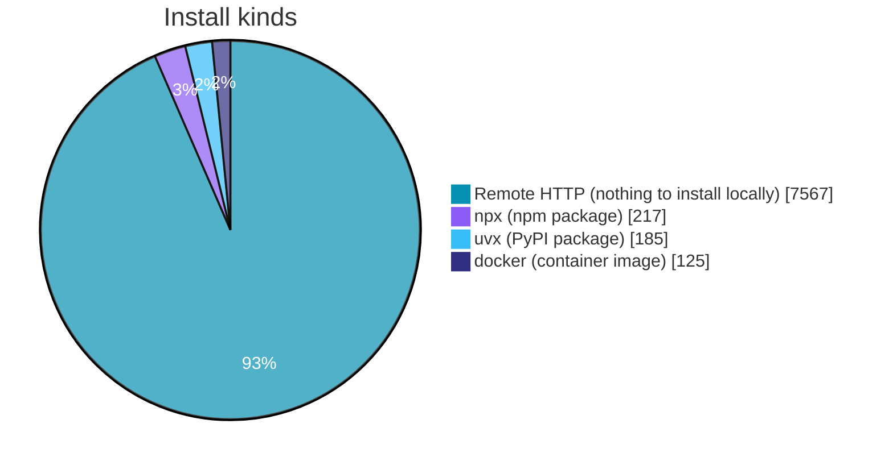

  

  

 

## 👋 Hi, I'm Sayidi

I'm a student from Bangladesh. While the biggest companies in the world race to build AI agents, I kept asking myself one question:

> **Can one person, with one laptop and no team, build a real AI agent engine?**

I tried. The answer is **ZYRAXON AI**: an open-source desktop agent that doesn't just answer.
**It does the work.**

 

## ⚡ What ZYRAXON does

A chatbot gives you words. ZYRAXON takes a **goal** and carries it all the way to a **result**.

It plans the steps, picks the right tools, runs them, reads what came back, fixes its own mistakes, and **checks the job is actually finished** before it tells you it is.

| 🧰 | 🔌 | 🎛️ | 🧠 |
|:---:|:---:|:---:|:---:|
| **888 tools** | **8,202 MCP servers** | **11 agent modes** | **Your model** |
| across 63 categories | one catalog, one place | plan · build · explore · auto and more | plug in the brain you prefer |

| 🖥️ | 🤝 | 🌍 | 🔓 |
|:---:|:---:|:---:|:---:|
| **Desktop · Terminal · SDK** | **Sub-agents** | **Control anything with an interface** | **Open source** |
| three ways to use it | parallel agents under one supervisor | commands, APIs, tools | read it, fork it, improve it |

**If something can be controlled through commands, APIs or tools, a ZYRAXON agent can drive it.** The few things that truly need human hands stay with a human, and the agent handles everything else.

 

  

 

## 🔌 The MCP Hub: 8,202 servers

MCP servers are the agent's **hands**. More hands, more power. The ZYRAXON MCP Hub puts **8,202 MCP servers** in one catalog:

- **8,094 servers** collected from the public MCP registry, each one tagged with **how far it was tested**
- **108 hand-curated apps** (Notion, Linear, Atlassian and more) with setup steps and guides
- **17 categories** and **64,000+ tools** observed across the catalog

| 8,202 | 8,094 | 108 | 17 | 64K+ |
|:---:|:---:|:---:|:---:|:---:|
| **total entries** | **from the public registry** | **hand-curated** | **categories** | **tools observed** |

> The full list lives in one file, generated by script from the catalog: **[`MCP Hub/ALL MCP.md`](https://github.com/onelpawarai-X/ZYRAXON-AI/blob/main/MCP%20Hub/ALL%20MCP.md)**

### 🔑 Every server connects the way it needs to

ZYRAXON shows you only the step that matters:

| If the server needs… | Servers | What you'll see |
|---|---:|---|
| ⚡ **Nothing at all** | 4,679 | Press **Connect**. The tools are live. |
| 🌐 **A browser sign-in** | 3,105 | A sign-in page opens, you approve, you're in. |
| 🔑 **An API key** | 228 | A short form asks for the key. |
| 🔗 **Your own address** | 82 | You paste your instance URL and go. |

### 🧪 How far each server was tested

Nothing here is marked "works" on faith. Every registry server carries a label for **how far the check went**:

| Proof level | Servers | What was proven |
|---|---:|---|
| ✅ **full** | 2,989 | `initialize`, `tools/list` and a read-only `tools/call` all answered |
| 🟢 **tools_list** | 1,391 | `initialize` and `tools/list` answered |
| 🔐 **auth_discovery** | 3,105 | a `401` was followed by a working sign-in discovery document |
| 🚀 **launched** | 228 | the package resolved, started, then asked for its key |
| 📍 **declared** | 82 | the endpoint is reachable but needs a value only you have |
| ⏳ **pending** | 299 | local packages listed, proof not yet recorded |

**7,795 of the 8,094 registry servers already carry recorded proof.** The remaining 299 are being worked through, and the label on each row tells you exactly where it stands.

### 📦 How servers install

<b>📂 See all 17 categories</b>

 

| Category | Servers |
|---|---:|
| AI & ML | 2,293 |
| General | 2,076 |
| Web & Search | 1,367 |
| Developer Tools | 731 |
| Communication | 327 |
| Data & Analytics | 277 |
| Finance & Crypto | 213 |
| Productivity & Docs | 164 |
| Design & Media | 149 |
| Maps & Travel | 121 |
| Databases | 95 |
| Business & CRM | 79 |
| Cloud & Infrastructure | 64 |
| Security | 51 |
| Knowledge & Memory | 44 |
| Files & Storage | 34 |
| IoT & Hardware | 9 |

[**→ Browse the full MCP catalog**](https://github.com/onelpawarai-X/ZYRAXON-AI/blob/main/MCP%20Hub/ALL%20MCP.md)

 

  

 

## 🧩 The ZYRAXON Model Provider

> [!IMPORTANT]
> **The ZYRAXON Model Provider is paused on purpose.**
> We will switch on our own provider only when this repository reaches **100,000 GitHub stars**. Until then, the provider endpoint replies with a short notice saying exactly this.
>
> **Want it sooner? [Star the repo](https://github.com/onelpawarai-X/ZYRAXON-AI) and share it.** Every star moves the date closer.

The ten-model lineup (**Apex · Matrix · Pulse · Titan · Neural · Codex · Visionary · Cyber · Quantum · Genesis**) is waiting for that day.

Meanwhile you lose nothing: the ZYRAXON agent works with the model you bring.

### ⭐ The road to 100K

 

## 🌍 Build this with me

I don't want to carry this alone. ZYRAXON is open source, and the next chapter is better when we write it together.

| | |
|---|---|
| 🧪 **Test** | Connect a few MCP servers and tell me what breaks |
| 🐛 **Report** | Open an issue for any bug or idea |
| 🔌 **Build** | Send a pull request with a tool or an integration |
| 📝 **Write** | Improve the docs, in English or Bengali |
| ⭐ **Spread** | Leave a star so more people can find it |

Student, senior engineer, or just curious: **there is a place for you here.**

 

### 🛠️ Built with

  

  

 

### **Think beyond the prompt. Build beyond the answer.**

[**GitHub**](https://github.com/onelpawarai-X/ZYRAXON-AI) · [**Website**](https://zyraxonai.lovable.app/) · [**MCP Hub**](https://github.com/onelpawarai-X/ZYRAXON-AI/tree/main/MCP%20Hub) · [**Agent Ecosystem Hub**](https://agent-ecosystem-hub.lovable.app/)

ZYRAXON AI © 2026 · See the repository for license and terms.

